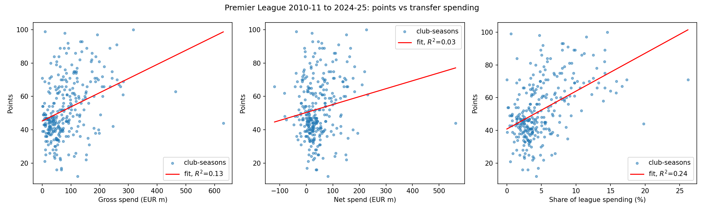
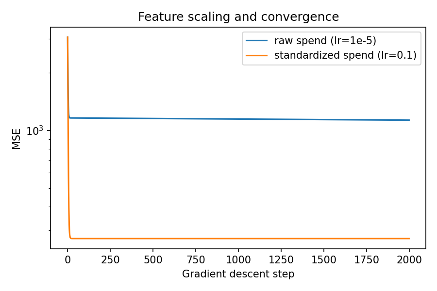
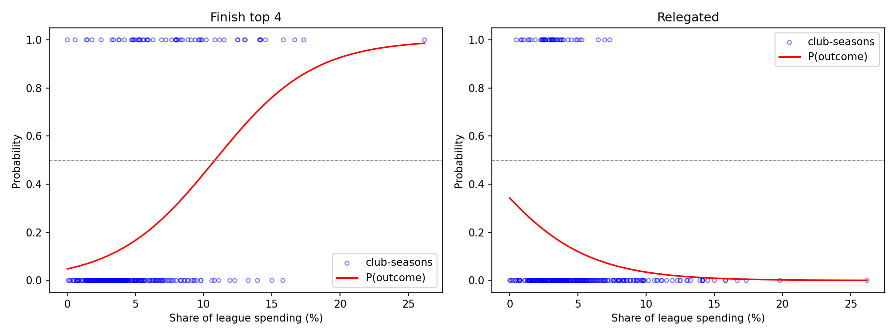
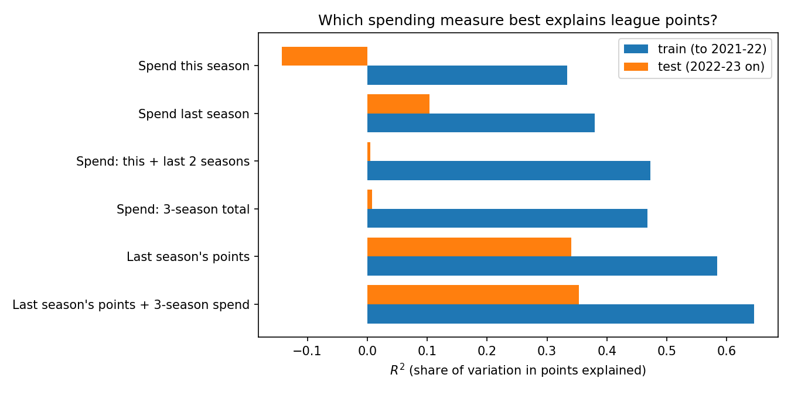
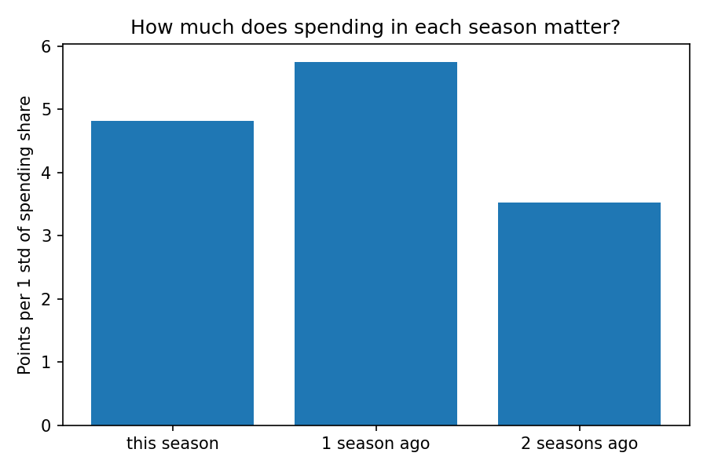

# Does Transfer Spending Buy Premier League Success?

An analysis of 15 Premier League seasons (2010-11 to 2024-25) asking how much a club's transfer spending explains its league results. Linear and logistic regression are implemented from scratch in NumPy and cross-checked against scikit-learn.

**Short answer:** less than you might think. Spending explains about a quarter of the variation in points within a season, its effect shows up with a delay, and last season's points predict this season far better than any spending measure.



## Data

| Source | Contents |
|---|---|
| [eordo/transfermarkt-data](https://github.com/eordo/transfermarkt-data) | Every Premier League transfer, scraped from Transfermarkt (fees in EUR) |
| [openfootball/football.json](https://github.com/openfootball/football.json) | Every Premier League match result |

`build_dataset.py` downloads both, computes each season's final table from the 380 match results, applies league-imposed point deductions (Everton and Nottingham Forest, 2023-24), and produces one row per club per season: **300 club-seasons**.

Spending features:

- **Gross spend**: total fees paid for incoming players
- **Net spend**: fees paid minus fees received
- **Spending share**: a club's gross spend as a percentage of the whole league's spend that season. Transfer fees have inflated sharply over 15 years, and normalizing within each season removes that trend.

## Method

`models.py` implements, with NumPy only:

- Linear regression by **gradient descent** and by the **normal equation**
- Logistic regression by gradient descent on the binary cross-entropy
- Feature standardization

Every fit is checked against the other method and against scikit-learn (`LinearRegression`, and `LogisticRegression` with the default L2 penalty switched off); the scripts assert that all three agree.

Standardizing features turned out to be essential. Raw spending is in the hundreds of millions, which makes the loss surface a long narrow valley: with a learning rate small enough not to diverge, gradient descent on raw spend still has 4x the error of the standardized version after 2,000 steps.



## Findings

### 1. Spending explains about a quarter of league points

| Feature | R² |
|---|---|
| Gross spend | 0.13 |
| Net spend | 0.03 |
| Spending share | **0.24** |

Normalizing by season nearly doubles the explanatory power, confirming that inflation was masking the relationship. Each extra percentage point of the league's spending is worth about **2.3 points**. Net spend is the weakest measure, likely because big clubs both buy and sell heavily.

For comparison, research popularized by *Soccernomics* (Kuper and Szymanski) found that **wage** spending explains roughly 90% of finishing position over time. Transfer fees are a much noisier signal of squad quality.

The largest gaps between model and reality tell their own stories. Liverpool won the 2019-20 title with 99 points while spending only 0.6% of the league total; the model expected 42. Their major signings (Van Dijk, Alisson) had come in the previous two seasons. At the other end, Chelsea spent nearly 20% of the league total in 2022-23 and finished 12th.

### 2. Spending predicts the top four, but not relegation



A club's probability of finishing in the top four passes 50% at about **10.8%** of league spending. But the model is only modestly better than always guessing "no" (82.7% vs 80.0% accuracy).

For relegation the fitted decision boundary falls at a *negative* spending share, so the model never predicts relegation at any level of spending. Transfer spending carries almost no information about which clubs go down.

### 3. Spending pays off with a delay, but past performance matters more

`lag_analysis.py` adds spending from the two previous seasons and last season's points, trains on 2010-11 to 2021-22, and tests on 2022-23 to 2024-25.



| Model | Train R² | Test R² |
|---|---|---|
| Spend this season | 0.33 | -0.14 |
| Spend last season | 0.38 | 0.10 |
| Spend this + last two seasons | 0.47 | 0.01 |
| Last season's points | 0.58 | 0.34 |
| Last season's points + 3-season spend | 0.65 | 0.35 |

- **Delayed effect.** In the three-season model, last season's spending has a larger coefficient (+5.7 points per standard deviation) than this season's (+4.8), and spending two seasons ago still contributes (+3.5). New signings take time to pay off.
- **Strong teams stay strong.** Last season's points alone beat every spending measure, and adding spending on top improves the fit only slightly.
- **Spending models fail on the test seasons.** The test period coincides with Chelsea's spending spree after the 2022 ownership change: three consecutive seasons near the top of the league in spending without matching results. Removing Chelsea raises the test R² of three-season spending from 0.01 to 0.20. One club spending inefficiently is enough to break a spending-based model.



## Limitations

- **Correlation, not causation.** Rich clubs can both spend more and win more; this analysis cannot separate the two.
- **Undisclosed fees.** About 7% of transfers have no published fee and are counted as zero (`n_fee_missing` tracks how many per club-season).
- **Promoted clubs are excluded from the lag analysis**, since they have no previous Premier League data. 86 of 300 club-seasons are dropped, so those results describe established Premier League clubs, while promoted clubs are the ones most at risk of relegation.
- **Small test set.** The held-out seasons contain 47 club-seasons, so test R² is noisy.
- **Tie-breakers.** The computed table ranks by points, goal difference, then goals scored, ignoring rarer tie-breaking rules.

## Future work

- Add **wage bills** (e.g. Capology estimates via FBref, or club accounts) to test whether wages outperform transfer fees, as the literature suggests.
- Use lagged features in the logistic models to improve relegation prediction.
- Rank clubs by **cost per point** to measure spending efficiency.

## Reproduce

```bash
pip install -r requirements.txt
python build_dataset.py   # downloads data, writes data/club_seasons.csv
python analysis.py        # single-season linear and logistic regression
python lag_analysis.py    # lagged spending and train/test evaluation
```

Figures are written to `figures/`.
